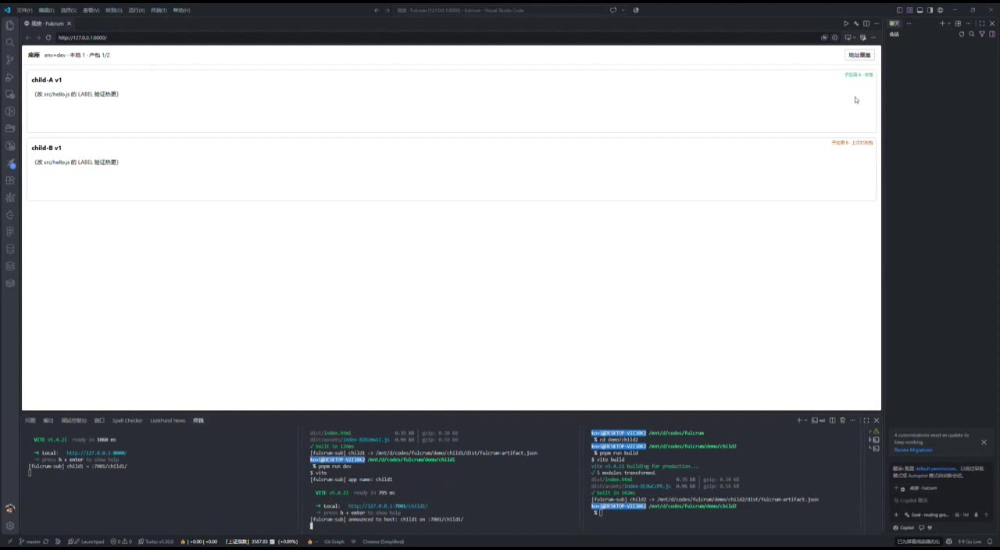

[简体中文](./README.zh-CN.md) · **English**

# fulcrum

A minimal implementation of a **register-and-discover** mechanism for micro-frontends. Built around
the lowest possible code intrusion, it forms a complete engineering workflow covering debugging,
release and sub-app management.

## The problem

Solid micro-frontend frameworks already exist — qiankun, wujie and friends. What I haven't seen is a
good answer to the question of **how you manage the sub-apps**.

Plenty of small and mid-size companies have thin frontend infrastructure. A monolith is painful, but
the moment you adopt micro-frontends new problems appear: how do you debug all these scattered apps
during development? And how do you keep them under control once they ship? That turns out to be the
hardest part.

fulcrum's answer: while debugging, no matter how many sub-apps on how many ports, everything is
reached through one port; when building, no matter which repo a sub-app lives in, a single server
path is enough to locate it.

## Demo

[](./demo/demo.mp4)

25-second recording. Three things happen at once: the host listens on the single port `8000`;
`child1` is started in its own directory and gets picked up immediately (its badge turns green —
"local dev"); `child2` isn't running, so it is served from the artifact of its last build.
Click the frame to play (mp4, 2.2 MB).

## Which package do I need

| You are… | Install |
|---|---|
| the host app | `@fulcrum/entry-vite` + `@fulcrum/cli` |
| a remote app | `@fulcrum/sub-vite` |

Loader-agnostic: this doesn't import wujie, qiankun, micro-app or anything else. It only decides
*where the request goes*; the loader in your host page decides *how it mounts*.

```js
// host vite.config.js
import { fulcrum } from '@fulcrum/entry-vite';
export default { plugins: [fulcrum()] };

// remote vite.config.js
import { announce, artifactManifest } from '@fulcrum/sub-vite';
export default { plugins: [announce(), artifactManifest()] };
```
## Configuration

### Host: `apps.manifest.json`

Place it at the project root (or up to 3 levels above the host's vite root — `fulcrum` finds it).
Two fields decide everything: `role` separates host from remotes, `base` is the same-origin path prefix.

```jsonc
{
  "env": "dev",
  "gateway": { "host": "127.0.0.1", "port": 8000 },
  "apps": [
    {
      "name": "base",           // loader instance id, globally unique
      "role": "host",           // exactly one host
      "base": "/",
      "port": 8000              // host port
    },
    {
      "name": "child2",         // must equal the remote's package.json appName
      "role": "remote",
      "base": "/child2/",       // must start and end with '/', no prefix overlaps
      "port": 7002,             // optional: hint for in-repo demos; cross-repo relies on discovery
      "dir": "../child2",       // optional: repo path, only used when spawning
      "remote": "https://test.example.com"  // remote or artifact: at least one
    }
  ]
}
```

Field reference:

| Field | Required | Notes |
|---|---|---|
| `name` | ✅ | loader instance id, globally unique, **must equal the remote's `appName`** |
| `role` | ✅ | `host` or `remote`; exactly one host |
| `base` | ✅ | same-origin prefix; remotes must end with `/` |
| `port` | host | host port; remotes may omit it (cross-repo relies on discovery) |
| `remote` | one of two | test-environment origin |
| `artifact` | one of two | artifact directory (omit and `fulcrum-artifact.json` is used instead) |
| `dir` / `enabled` / `pin` / `proxyTimeout` | optional | spawn path / spawn under `--all` / force remote / per-app timeout |

Full validation rules: [`packages/entry-vite/README.md`](./packages/entry-vite/README.md#manifest-fields).

### Remote: add `appName` to package.json

`appName` is the remote's stable id inside the micro-frontend system and **must equal the matching
`name` in the manifest**. Don't use the package name as the id: names carry scopes, get renamed on
publish, and private forks can collide.

```json
// remote package.json
{ "name": "@fulcrum/child-two", "appName": "child2" }
```

```js
// remote vite.config.js — no port to hardcode; announce() reports it once the dev server is up
import { announce, artifactManifest } from '@fulcrum/sub-vite';
export default { plugins: [announce(), artifactManifest()] };
```

A remote with `announce()` POSTs the host as soon as its dev server listens (silently skipped when
the host is down); `artifactManifest()` writes `fulcrum-artifact.json` after every build so the host
can find artifacts without configuration and catch a mis-configured `base`.

## Run the demo

```bash
pnpm install
cd demo/entry && pnpm dev          # host on :8000
cd demo/child1 && pnpm dev          # remote A, discovered within 2s
```

Then `pnpm build` / `pnpm preview` / `pnpm check` from `demo/entry`.

## Docs

| Package | Docs |
|---|---|
| `@fulcrum/entry-vite` | [EN](./packages/entry-vite/README.md) · [中文](./packages/entry-vite/README.zh-CN.md) |
| `@fulcrum/sub-vite` | [EN](./packages/sub-vite/README.md) · [中文](./packages/sub-vite/README.zh-CN.md) |
| `@fulcrum/cli` | [EN](./packages/cli/README.md) · [中文](./packages/cli/README.zh-CN.md) |
| demo | [中文](./demo/README.md) |

## Tests

```bash
pnpm test                          # entry-vite unit tests
cd demo/entry && pnpm test         # resolve + e2e
```

## License

MIT
