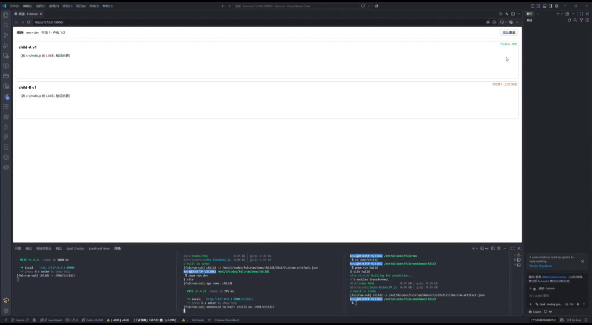

[English](./README.md) · **简体中文**

# fulcrum

这是一个微前端的**注册发现机制**最小版本实现方案，以最低代码侵入为核心，构建覆盖调试、发布与子应用管理的完整工程化流程。

## 解决的问题

市面上已经有很多优秀的微前端方案了——qiankun、wujie 这些都很成熟，但围绕"**子应用怎么管理**"这件事，我却没见到几个像样的答案。

很多中小公司的前端基建是匮乏的。巨石应用固然让人难受，可一旦接入微前端，新的难题立刻出现：开发时怎么调试分散在各处的这些应用？上线后又怎么把它们管理好？这才是最大的痛点。

fulcrum 给出的答案是：调试时，无论多少个子应用开多少个端口，都统一在一个端口下开发调试；打包时，无论子应用在哪个仓库，填一个服务器访问路径就能找到对应的应用。

## 演示

[](./demo/demo.mp4)

25 秒录屏。画面里同时发生三件事：底座只占 `8000` 一个端口；`child1` 在它自己的目录里起服务后被即时认到（右上角标变成绿色「本地调试」）；`child2` 没起服务，直接用上次构建的产物顶上。点画面播放（mp4，2.2 MB）。

## 该装哪个包

| 你是 | 装什么 |
|---|---|
| 底座应用 | `@fulcrum/entry-vite` + `@fulcrum/cli` |
| 子应用 | `@fulcrum/sub-vite` |

与加载器无关：不 import wujie、qiankun、micro-app 里的任何一个。它只管**请求该去哪**；
底座页面里的加载器管**怎么挂载**。

```js
// 底座 vite.config.js
import { fulcrum } from '@fulcrum/entry-vite';
export default { plugins: [fulcrum()] };

// 子应用 vite.config.js
import { announce, artifactManifest } from '@fulcrum/sub-vite';
export default { plugins: [announce(), artifactManifest()] };
```
## 配置

### 底座：apps.manifest.json

放在项目根（或底座 vite root 往上最多 3 层内，`fulcrum` 都能找到）。两个字段决定一切：`role` 区分底座与子应用，`base` 是同源路径前缀。

```jsonc
{
  "env": "dev",
  "gateway": { "host": "127.0.0.1", "port": 8000 },
  "apps": [
    {
      "name": "base",           // 加载器实例 id，全局唯一
      "role": "host",           // 有且仅有一个 host
      "base": "/",
      "port": 8000              // 底座端口
    },
    {
      "name": "child2",         // 必须等于子应用 package.json 的 appName
      "role": "remote",
      "base": "/child2/",       // 必须以 / 开头且以 / 结尾，互不前缀冲突
      "port": 7002,             // 可选：仓库内 demo 的提示值，跨仓靠扫描发现
      "dir": "../child2",       // 可选：仓库相对路径，只用于代起
      "remote": "https://test.example.com"  // remote 与 artifact 至少给一个
    }
  ]
}
```

字段速查：

| 字段 | 必填 | 说明 |
|---|---|---|
| `name` | ✅ | 加载器实例 id，全局唯一，**必须等于子应用的 `appName`** |
| `role` | ✅ | `host` 或 `remote`，有且仅有一个 host |
| `base` | ✅ | 同源路径前缀；remote 必须以 `/` 结尾 |
| `port` | host 必填 | 底座端口；子应用可省（跨仓靠发现） |
| `remote` | remote 二选一 | 测试环境 origin |
| `artifact` | remote 二选一 | 产物目录（不写就靠 `fulcrum-artifact.json` 自动找） |
| `dir` / `enabled` / `pin` / `proxyTimeout` | 可选 | 代起路径 / `--all` 是否代起 / 强制走测试环境 / 单应用超时 |

完整校验规则见 [`packages/entry-vite/README.zh-CN.md`](./packages/entry-vite/README.zh-CN.md#manifest-字段)。

### 子应用：package.json 加 appName

`appName` 是子应用在微前端体系里的稳定 id，**必须等于 manifest 里对应条目的 `name`**。不用包名当 id，因为包名带 scope、会随发布改名、私有 fork 可能重名。

```json
// 子应用 package.json
{ "name": "@fulcrum/child-two", "appName": "child2" }
```

```js
// 子应用 vite.config.js —— 端口不用写死，dev server 起来后自动上报给底座
import { announce, artifactManifest } from '@fulcrum/sub-vite';
export default { plugins: [announce(), artifactManifest()] };
```

装了 `announce()` 的子应用起服务时立刻 POST 底座（底座没起则静默跳过）；`artifactManifest()` 在每次 build 后写 `fulcrum-artifact.json`，底座据此免配置找到产物，并校验 `base` 没配错。

## 跑 demo

```bash
pnpm install
cd demo/entry && pnpm dev          # 底座 :8000
cd demo/child1 && pnpm dev          # 子应用 A，2s 内被认到
```

然后在 `demo/entry` 里 `pnpm build` / `pnpm preview` / `pnpm check`。

## 文档

| 包 | 文档 |
|---|---|
| `@fulcrum/entry-vite` | [中文](./packages/entry-vite/README.zh-CN.md) · [EN](./packages/entry-vite/README.md) |
| `@fulcrum/sub-vite` | [中文](./packages/sub-vite/README.zh-CN.md) · [EN](./packages/sub-vite/README.md) |
| `@fulcrum/cli` | [中文](./packages/cli/README.zh-CN.md) · [EN](./packages/cli/README.md) |
| demo | [中文](./demo/README.md) |

## 测试

```bash
pnpm test                          # entry-vite 单测
cd demo/entry && pnpm test         # resolve + e2e
```

## License

MIT
