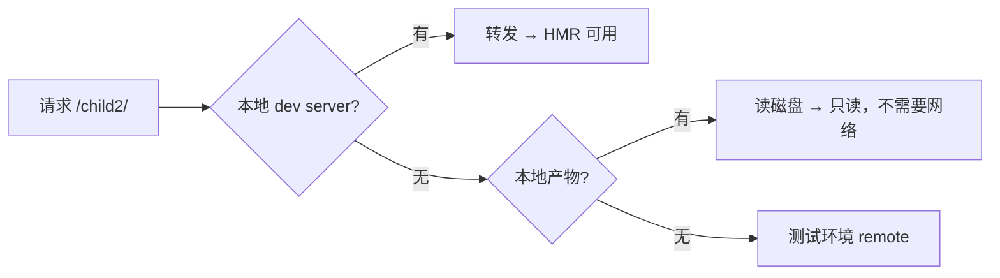

# Fulcrum · 示例底座与调试骨架

> 包本体在仓库根目录（`@fulcrum/entry-vite`）和 `sub/`（`@fulcrum/sub-vite`）。
> 这个目录是**脚手架**：一个 wujie 基座、两个示例子应用、以及操作它们的 CLI。
> 不发布，随便改。

## 目录

```
demo/
  entry/                  基座（wujie 外壳）
    index.html            页面：三个 slot、健康角标、地址覆盖面板
    src/boot.js           预检 → startApp → 沙箱健康 → 三态标签
    src/runtime/          地址解析、沙箱检测、错误类型
    vite.config.js        只挂一个插件：fulcrum()
    apps.manifest.json    清单（团队共享，入库）
    apps.manifest.demo.json  演示清单（remote 指向本地 7999 替身）
    tests/                e2e（开发态）、build.e2e（产物）、resolve 单测
    package.json          脚本只是转调包里的 CLI
  child1/                 示例子应用 A
  child2/                 示例子应用 B
```

demo 下只有三个文件夹：`entry` 是基座，`child` / `child2` 是子应用。
清单在 `entry/` 里——因为 `entry` 是这个工作区的入口，cwd 从这里开始。

**没有 `dev/` 目录**：那些脚本（起底座、打站点、收尸、校验、模拟测试环境）都跟微前端有关，
跟"示例基座长什么样"无关，已经做成独立的 `@fulcrum/cli` 包：

```bash
fulcrum dev | build | preview | stop | check | mock-env
```

demo 的 `package.json` 就是普通项目的样子，没有任何路径技巧：

```json
"devDependencies": { "@fulcrum/entry-vite": "workspace:*", "@fulcrum/cli": "workspace:*" },
"scripts": { "dev": "fulcrum dev", "build": "fulcrum build", "check": "fulcrum check" }
```

`pnpm install` 之后 `fulcrum` 会被链到 `demo/entry/node_modules/.bin/fulcrum`，
且三个包的 `prepare` 脚本会自动编译出 `dist/`（类型声明一起生成）。
子应用同理：只装 `@fulcrum/sub-vite`，`vite.config.js` 里
`import { announce, artifactManifest } from '@fulcrum/sub-vite'`。

包全部是 TypeScript；`entry/`、`child/`、`child2/` 里的示例应用仍用 .js ——
它们是给人抄的模板，保持最短路径，且加载器（wujie）没有官方类型声明。

manifest 里的 `dir` 因此写成 `.`（基座自己）和 `../child` / `../child2`（同级的兄弟目录）。
这也顺便证明了路径解析不依赖"子应用在底座目录下"。

## 快速开始

```bash
pnpm install          # 仓库根装一次，workspace 会把包链到各应用

cd demo/entry
pnpm dev              # 只起底座 http://127.0.0.1:8000/
```

另开终端，进某个子应用目录起它：

```bash
cd demo/child1 && pnpm dev     # vite 自己选端口，底座 2s 内认到
cd demo/child2 && pnpm dev
```

页面打开后，已启动的子应用标签是绿色的「本地」，没启动的会显示「上次打的包」或「测试环境」。

想一次全起（仅仓库内调试）：

```bash
pnpm dev -- child child2     # 指定代起
pnpm dev -- --all            # 全起
```

## 三级回落

底座对每个请求现算目标，所以改一个子应用只需要起一个：



## 跨仓：子应用放哪都行

子应用在自己仓库里 `pnpm dev` 即可，底座自己找上门。身份凭证是 `package.json` 的 `appName`：

```json
{ "name": "@acme/child-two", "appName": "child2" }
```

`appName` 必须等于 `apps.manifest.json` 里该应用的 `name`。用 `appName` 而不是包名，
是因为包名会带 scope、会随发布改名。

两条发现通道：

| 通道 | 触发 | 延迟 | 前提 |
|---|---|---|---|
| announce | 子应用装了 `@fulcrum/sub-vite` | 即时 | 子应用 import 插件 |
| 扫描 | 每 2s 读本机 LISTEN 端口 → pid → package.json | ≤2s | 无 |

扫描要过三关才算认领：端口在 LISTEN → `appName` 匹配 → `GET {base}` 的 HTML 里确实带
`{base}` 前缀的资源。第三关不能省，否则 `node scripts/seed.js` 这种同名进程会被误判。

性能实测（容器内 9 个进程）：

```
常态一 tick（只读 /proc/net/tcp，端口集合没变就 return）  1.16 ms  → 占单核 0.053%
端口变化时的全机 fd 扫描                                0.16 ms
```

真机上 fd 扫描约 10ms，但只在端口集合变化时跑一次；无人访问 30s 后间隔从 2s 降到 10s。

## 打包

```bash
pnpm build               # 底座 + 全部子应用 → dist/site/（清空重建）
pnpm build -- child      # 增量：只重打 A，其它应用的产物保留
pnpm build -- --clean    # 强制全清
pnpm build --with child  # 进子应用仓库跑它自己的 build，再收集产物
pnpm preview             # 静态伺服 dist/site（寻址方式与线上一致）
pnpm test:build          # 产物验收 17 项
```

产物结构（一个 root 覆盖全部应用，不用给每个子应用配 alias）：

```
dist/site/
  index.html          底座
  assets/…            底座资源（带 hash）
  child1/index.html   A → /child1/
  child2/index.html   B → /child2/
dist/fulcrum-manifest.json   本次构建清单
dist/nginx.conf              可直接用的示例配置
```

子应用 build 完会在产物目录写 `fulcrum-artifact.json`：

```json
{ "appName": "child2", "base": "/child2/", "builtAt": "...", "commit": null }
```

底座据此免配置找包，并且能做两件原来做不到的事：判过期（`/__mf/status` 里显示"3 小时前"）、
防错配（清单的 `base` 与 manifest 不一致直接拒绝，否则线上白屏）。

跨仓拿不到源码时，`build` 现打失败会**退回复用上次产物并告警**，不会让整次发版挂掉
——静默用旧包是最难查的事故。

## 多终端：底座已经在跑，再起一个子应用

```bash
# 终端 1
pnpm dev -- child

# 终端 2（不会抢 8000，也不重启底座）
pnpm dev -- child2
```

底座不用重启：转发目标是每个请求现算的，页面标签每 2s 从 `/__mf/status` 刷新，
目标变化时自动重挂。

## 卡住不动怎么定位

`pnpm dev` 有 6 个打点，卡在哪一步一眼可见：

```
[dev] 1/6 读 manifest  (+1ms)
[dev] 2/6 端口体检（底座 8000，不代起任何子应用）  (+2ms)
[dev] 3/6 生成 proxy（manifest 写错会在这里就炸）  (+9ms)
[dev] 4/6 跳过：不代起子应用  (+10ms)
[dev] 5/6 跳过：没有代起的子应用  (+12ms)
[dev] 6/6 起底座  (+465ms)
```

| 停在 | 原因 | 处理 |
|---|---|---|
| 没有任何 `[dev]` 输出 | `node dev.js` 都没跑起来 | `node --version`（要 ≥18） |
| `2/6` | 端口被上一轮占着 | `pnpm stop` |
| `3/6` | manifest 写坏了（缺 base、base 前缀冲突等） | 看报错那一行，改 `apps.manifest.json` |
| `4/6` 后子应用报错退出 | 依赖没装好 / pnpm 拦了 esbuild | `pnpm install`；pnpm 用户见下 |
| `6/6` 报"找不到 vite" | 依赖没装（会向上找 4 层） | `pnpm install` |

### pnpm 注意

pnpm 10+ 默认**拦截依赖的构建脚本**，esbuild 的 postinstall 被拦后 vite 起不来。仓库根有
`pnpm-workspace.yaml` 放行（`allowBuilds: esbuild: true`）；别的项目遇到
`ERR_PNPM_IGNORED_BUILDS` 就跑 `pnpm approve-builds`。

vite 不通过 `npx` 启动，而是 `node <找到的 vite>/bin/vite.js`——避免 npx 在本地没装时
交互式询问（在脚本里表现为永远挂着、无输出），也少一层 `sh -c`，Ctrl-C 后不留孤儿进程。

## proxy 超时与 502

每条规则带 5s 超时。目标连不上时：终端打印可读指引（哪个应用、目标是本地还是测试环境、
怎么修），页面立刻收到 502 走失败面板，而不是空白或无限转圈。
manifest 里可用 `proxyTimeout` 单应用覆盖。

## 两套 manifest

| 文件 | 用途 |
|---|---|
| `apps.manifest.json` | 你要改的。`remote` 现在是占位域名，换成真实测试环境 |
| `apps.manifest.demo.json` | 演示用：`remote` 指向 `fulcrum mock-env`（7999） |

切换：`MF_MANIFEST=apps.manifest.demo.json pnpm dev -- child`

## 运行时状态文件

启动时"这次本机起了哪几个应用"有两个通道：

| 通道 | 说明 |
|---|---|
| 环境变量 `MF_LOCAL_APPS` | 主通道，不碰磁盘 |
| `.mf-dev-local.json` | 只做留痕，供手工起 vite 时兜底 |

文件属主不对、写不进去，只会在终端给一行提示，**不会让启动失败**。
同理 `.dev-pids.json` 丢了也能停：`pnpm stop` 按端口反查 PID
（`ss` → `lsof` → 直读 `/proc`），最后用 TCP 连接复核，不谎报"端口已释放"。

## 已知边界

- 走 `artifact` 档没有 HMR，改代码要重新 build
- 产物是静态文件，`/child2/` 的深链要靠 `try_files`（`dist/nginx.conf` 已写好）
- 端口被别的程序占用且恰好同 base 时可能误认，用 manifest 的 `port` 或 `pin: "remote"` 收窄
- demo 子应用不各自装依赖：`vite` 从仓库根的 `node_modules` 解析（向上找 4 层）
- `apps/child`、`apps/child2` 的 `base` 必须与 manifest 一致，写错会拉到别人的 HTML
