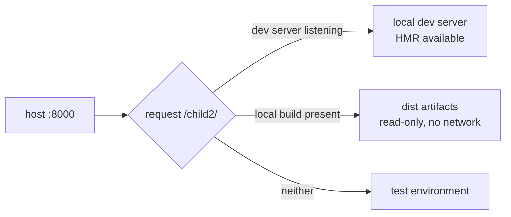

**English** · [简体中文](./README.zh-CN.md)

# @fulcrum/entry-vite

A **host-side** Vite plugin for micro-frontends. **Loader-agnostic** — wujie, qiankun, micro-app or a hand-rolled iframe all work; it only decides *where a request goes*. One line to plug in, three problems solved:

1. **Decoupled repos** — the host finds each sub-app on its own port; you don't declare it
2. **Three-tier fallback** — local dev server → last build's artifacts → test environment. Change one app, start one app
3. **Same-origin forwarding** — the host only ever requests paths like `/child2/`, so no CORS and no environment branches inside components

> Companion sub-app plugin: [@fulcrum/sub-vite](../sub-vite/README.md)

## Relationship to the loader (wujie / qiankun / …)

This package **imports no micro-frontend framework**. It does two loader-independent things:

1. **Addressing** — routes requests like `/child2/` to one of: local dev server / local build / test environment
2. **Discovery** — knows which port each sub-app is on right now

The loader (wujie and friends) runs in the **host page** and mounts `/child2/` into a sandbox.
The only contract between the two is:

```
host page requests /<base>/ → this plugin guarantees it receives the right HTML and assets
```

Swapping the loader doesn't touch this package; upgrading this package doesn't touch loader code.
`demo/` in this repo holds the **wujie demo host** plus example sub-apps — scaffolding, not part of the package.
See [`demo/README.md`](../../demo/README.md).

## Install

```bash
pnpm add -D @fulcrum/entry-vite
```

`vite` is a peer dependency (>= 4) and is not installed twice.

## Quick start

```js
// vite.config.js
import { defineConfig } from 'vite';
import { fulcrum } from '@fulcrum/entry-vite';

export default defineConfig({
  plugins: [fulcrum()],
});
```

```json
// apps.manifest.json
{
  "env": "dev",
  "gateway": { "host": "127.0.0.1", "port": 8000 },
  "apps": [
    { "name": "base", "role": "host", "base": "/", "port": 8000 },
    {
      "name": "child2",
      "role": "remote",
      "base": "/child2/",
      "remote": "https://test.example.com"
    }
  ]
}
```

Then:

```bash
pnpm dev
# host on http://127.0.0.1:8000/
# run `pnpm dev` inside each sub-app repo — discovered within 2s
```

## CLI

The plugin only answers "where should this request go". Running and shipping many apps at once is
[`@fulcrum/cli`](../cli/README.md) (`fulcrum dev / build / preview / stop / check / mock-env`).

Why split: the CLI needs manifest / gateway / artifact internals, but those must not become public
API. The package exposes a single `@fulcrum/entry-vite/internal` subpath for the CLI; the plugin
itself exports only `fulcrum()`.

## How it works



The target is resolved **per request**, so switching never requires a host restart. When a
sub-app starts or stops, the `/__mf/status` labels in the page follow within 2s.

## Options

| Option | Type | Default | Description |
|---|---|---|---|
| `manifest` | `string` | `<root>/apps.manifest.json` | Manifest path; `MF_MANIFEST` also works |
| `localNames` | `string[]` | none | Initial hint before the first scan completes; scans win afterwards |
| `artifactRoot` | `string` | `<root>/dist/site` | Root directory for build artifacts |
| `scanIntervalMs` | `number` | `2000` | Max scan interval; drops to 10s after 30s idle |
| `log` | `boolean` | `true` | Print discovery / announce logs |

## Manifest fields

### Top level

| Field | Required | Description |
|---|---|---|
| `env` | no | Environment label, defaults to `dev`, display only |
| `gateway.host` | no | Bind address, defaults to `127.0.0.1` |
| `gateway.port` | no | Fallback for the `preview` CLI only; the host dev/build port comes from the host entry's `port` |
| `apps` | yes | Non-empty list of apps |

### App entry

| Field | host | remote | Description |
|---|---|---|---|
| `name` | required | required | Loader instance id, globally unique. **Must equal the sub-app's `package.json` `appName`** |
| `role` | required | required | `host` \| `remote`; exactly one host |
| `base` | required | required | Path prefix, e.g. `/child2/`. Remote bases must end with `/` |
| `port` | required | optional | Host port / sub-app dev port hint |
| `title` | no | no | Display name |
| `remote` | — | either | Test environment origin, e.g. `https://test.example.com` |
| `artifact` | — | either | Artifact directory, absolute or relative to root |
| `dir` | — | optional | Repo-relative path; only used when the host spawns sub-apps |
| `proxyTimeout` | — | optional | Per-app proxy timeout in ms, defaults to 5000 |
| `pin` | — | optional | Set `"remote"` to never use a local server (useful when the port is squatted) |

At least one of `remote` / `artifact` must be present, otherwise the app is guaranteed to fail
when no dev server is running.

## Validation

Validated when `fulcrum()` starts. Bad config fails loudly with the exact field, never silently:

- `name` unique and non-empty
- exactly one `role: "host"`
- `base` starts with `/`; remote bases end with `/` (otherwise relative asset paths break)
- two remote bases cannot be prefixes of each other (`/child/` vs `/child2/` steal each other's routes)
- explicit `port` values must not collide
- `port` must be an integer in 1–65535

## HTTP endpoints

| Endpoint | Method | Purpose |
|---|---|---|
| `/__mf/status` | GET | Per-app state: `mode` (`local`/`artifact`/`remote`), actual port, discovery source, artifact age |
| `/__mf/announce` | POST | Sub-app dev server reports `{appName, port, base}` |
| `/__mf/unannounce` | POST | Released on sub-app shutdown |

Sample `/__mf/status` response (human-readable strings such as `artifactAge` are in English;
the machine fields `mode` / `source` / `artifactSource` are language-neutral):

```json
{
  "ok": true,
  "apps": [
    {
      "name": "child2",
      "base": "/child2/",
      "port": 7002,
      "source": "announce",
      "local": true,
      "mode": "local",
      "artifactSource": null,
      "artifactAge": null
    },
    {
      "name": "child3",
      "base": "/child3/",
      "port": null,
      "source": null,
      "local": false,
      "mode": "artifact",
      "artifactSource": "dir",
      "artifactAge": "3 hours ago"
    }
  ],
  "local": ["child2"],
  "artifact": ["child3"]
}
```

## Injected globals

The plugin injects three values through vite's `define`. Host code must reference them as
**bare identifiers**:

| Variable | Content |
|---|---|
| `__MF_MANIFEST__` | The whole manifest object |
| `__MF_LOCAL__` | Local app names at startup (always empty in `build`) |
| `__MF_PROD__` | `true` when building for production |

```js
const manifest = __MF_MANIFEST__;             // ✅
const manifest = globalThis.__MF_MANIFEST__;  // ❌ define only replaces bare identifiers
```

`globalThis.X` is a property access, so it is **not replaced at build time**. The bundle keeps a
read of an undefined property, which shows up in production as a blank page plus
`Cannot read properties of undefined (reading 'apps')`.

## Discovery

Two channels claim a running sub-app:

| Channel | Trigger | Latency | Requirement |
|---|---|---|---|
| **announce** | Sub-app uses `@fulcrum/sub-vite`; posts on dev server start | instant | Sub-app imports the plugin |
| **scan** | Every 2s: read listening ports → pid → `package.json` | ≤2s | none |

The scan channel must pass three gates:

1. the port is in LISTEN
2. `appName` matches (read from the process cwd's `package.json`, or via HTTP `{base}package.json`)
3. `GET {base}` returns HTML whose assets are actually prefixed with `{base}`

Gate 3 is not optional: gate 2 only proves "a process from that repo is running".
Something like `node scripts/seed.js` would pass the first two gates and fail the third.

### Performance

Measured in a container (9 processes on the machine):

```
steady-state tick (read /proc/net/tcp only; return early if the port set is unchanged)  1.16 ms  → 0.053% of one core
full fd scan when the port set changes                                                 0.16 ms
```

On a real machine the fd scan is in the ~10ms range, but it only runs when the **port set changes**.
Apps using announce skip scanning entirely. After 30s with no page polling, the interval drops
from 2s to 10s; any `/__mf/status` request brings it back to 2s.

Platform support: Linux reads `/proc` (exact, no `ss`/`lsof` needed); macOS / Windows fall back to
`netstat` plus HTTP probing.

## Artifact discovery

You do **not** need to write `artifact` in the manifest. The host resolves in this order, first hit wins:

```
1. manifest.artifact (explicit, most predictable)
2. <dir>/dist/fulcrum-artifact.json (same-repo sub-app)
3. $MF_APPS_DIR/*/dist/fulcrum-artifact.json (cross-repo scan)
4. <artifactRoot>/<name> (whatever the host itself built)
```

`fulcrum-artifact.json` is written by `artifactManifest()` from `@fulcrum/sub-vite`:

```json
{
  "appName": "child2",
  "base": "/child2/",
  "builtAt": "2026-11-18T06:12:00.000Z",
  "commit": "a1b2c3d",
  "name": "demo-child2"
}
```

Three uses:

| Use | Behavior |
|---|---|
| Zero config | No absolute paths to maintain in the manifest |
| Staleness | `/__mf/status` shows "3 hours ago" |
| Mismatch guard | Artifact `base` differs from the manifest → **refused** (otherwise a blank page with no clue) |

## Environment variables

| Variable | Purpose |
|---|---|
| `MF_MANIFEST` | Manifest path, takes precedence over the plugin option |
| `MF_APPS_DIR` | Search root for cross-repo artifacts (e.g. `~/work`) |
| `MF_LOCAL_APPS` | Comma-separated local app names; orchestrators use it to say "I spawned these" |
| `MF_ROOT` | Project root; set automatically in `configResolved`, can be set manually for CLIs |

## Advanced: use the lower-level modules

`fulcrum()` is the assembled plugin. When you need your own flow (CLI, tests, custom middleware),
import only the piece you need:

```js
import {
  loadManifest,        // read + validate the manifest
  createDiscovery,     // port discovery
  createLocalWatcher,  // local liveness table
  createMfProxy,       // HTTP + ws forwarding middleware
  resolveArtifact,     // artifact resolution
  buildProxy,          // build a vite server.proxy shape (for validation)
  setRoot,             // set the project root
} from '@fulcrum/entry-vite';
```

See `src/index.ts` for the full export list.

## Known limits

- **`server.proxy` is not used**: vite ships a trimmed http-proxy without the `router` option, so
  the target can only be fixed at startup. This plugin implements forwarding itself (`src/proxy.ts`);
  don't configure `server.proxy` alongside it.
- **Artifacts are static**: the `artifact` tier has no HMR. Edit code, rebuild.
- **Relative-path sub-apps**: non-vite dev servers that emit relative asset URLs
  (`src="./main.js"`) weaken gate 3 to "200 plus base in HTML", lowering hit rate. Use the
  announce plugin in that case.
- **Squatted ports**: the scan channel only verifies "listening + HTML carries base". In edge cases
  an unrelated service on the same base could be claimed. Narrow it with `pin: "remote"` or an
  explicit `port` in the manifest.

## License

MIT
