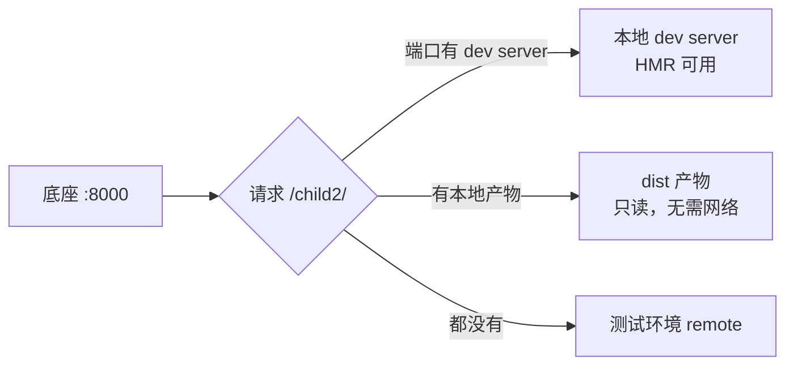

[English](./README.md) · **简体中文**

# fulcrum-entry-vite

微前端**底座侧**的 vite 插件。**与加载器无关**——wujie、qiankun、micro-app、甚至手写 iframe 都能用，它只管“请求该转发到哪”。一行接入，解决三件事：

1. **父子解耦**：子应用在哪个仓库、哪个端口，底座自己找，不用你填
2. **三级回落**：本地 dev server → 上次打的包 → 测试环境，改一个只起一个
3. **同源转发**：底座只请求 `/child2/` 这类同源路径，没有 CORS，组件里没有环境判断

> 配套的子应用侧插件：[fulcrum-sub-vite](../sub-vite/README.zh-CN.md)

## 与加载器（wujie/qiankun/…）的关系

这个包**不 import 任何微前端框架**，它只做两件与框架无关的事：

1. **寻址**：把 `/child2/` 这类请求转发到「本地 dev server / 本地产物 / 测试环境」三者之一
2. **发现**：知道每个子应用此刻在哪个端口

加载器（wujie 等）在**底座页面**里跑，负责把 `/child2/` 塞进沙箱。两者的唯一契约是：

```
底座页面请求 /<base>/ → 这个插件保证它拿到正确的 HTML 和资源
```

所以换加载器不需要改这个包；这个包升级也不会碰你的加载器代码。
仓库里的 `demo/` 是 **wujie 示例底座 + 示例子应用**，属于脚手架，不在包的范围内。
见 [`demo/README.md`](../../demo/README.md)。

## 安装

```bash
pnpm add -D fulcrum-entry-vite
```

`vite` 是 peer dependency（>= 4），不会重复安装。

## 快速开始

```js
// vite.config.js
import { defineConfig } from 'vite';
import { fulcrum } from 'fulcrum-entry-vite';

export default defineConfig({
  plugins: [fulcrum()],
});
```

```json
// apps.manifest.json
{
  "env": "dev",
  "gateway": { "host": "127.0.0.1", "port": 8000 },
  "apps": [
    { "name": "base", "role": "host", "base": "/", "port": 8000 },
    {
      "name": "child2",
      "role": "remote",
      "base": "/child2/",
      "remote": "https://test.example.com"
    }
  ]
}
```

然后：

```bash
pnpm dev
# 底座 http://127.0.0.1:8000/
# 子应用在自己的仓库里 pnpm dev，2s 内自动被认到
```

## 命令行

插件只管"请求该转发到哪"；"多个应用一起跑、一起打包发版"这部分是独立的
[`fulcrum-toolchain`](../cli/README.zh-CN.md)（`fulcrum dev / build / preview / stop / check / mock-env`）。

为什么拆开：CLI 需要 manifest / gateway / artifact 这些内部实现，但它们不该变成公共 API。
包里只开一个 `fulcrum-entry-vite/internal` 子路径给 CLI 用，插件本身只有 `fulcrum()` 一个导出。

## 工作原理



三个目标**每个请求现算**，不重启底座就能切换。子应用起来/关掉时，页面上的
`/__mf/status` 标签会在 2s 内跟着变。

## 配置项

| 选项 | 类型 | 默认 | 说明 |
|---|---|---|---|
| `manifest` | `string` | `<root>/apps.manifest.json` | manifest 路径，也可用 `MF_MANIFEST` 环境变量 |
| `localNames` | `string[]` | 无 | 启动初值：首次扫描完成前先把这些当作本地（之后以扫描结果为准） |
| `artifactRoot` | `string` | `<root>/dist/site` | 产物根目录 |
| `scanIntervalMs` | `number` | `2000` | 扫描间隔上限；闲置 30s 后自动降到 10s |
| `log` | `boolean` | `true` | 是否打印发现/上报日志 |

## manifest 字段

### 顶层

| 字段 | 必填 | 说明 |
|---|---|---|
| `env` | 否 | 环境名，默认 `dev`，只用于展示 |
| `gateway.host` | 否 | 底座绑定地址，默认 `127.0.0.1` |
| `gateway.port` | 否 | 仅 `preview` CLI 用作兜底；底座 dev/build 的端口取 host 条目的 `port` |
| `apps` | 是 | 应用列表，非空 |

### 应用条目

| 字段 | host | remote | 说明 |
|---|---|---|---|
| `name` | 必填 | 必填 | 加载器实例 id，全局唯一。**必须等于子应用 `package.json` 的 `appName`** |
| `role` | 必填 | 必填 | `host` \| `remote`，有且仅有一个 host |
| `base` | 必填 | 必填 | 路径前缀，如 `/child2/`。remote 必须以 `/` 结尾 |
| `port` | 必填 | 可选 | 底座端口 / 子应用 dev 端口提示 |
| `title` | 否 | 否 | 展示名 |
| `remote` | — | 二选一 | 测试环境 origin，如 `https://test.example.com` |
| `artifact` | — | 二选一 | 产物目录，绝对路径或相对根目录 |
| `dir` | — | 可选 | 仓库相对路径，只用于"底座代起子应用"的仓库内场景 |
| `proxyTimeout` | — | 可选 | 该应用单独的代理超时（ms），默认 5000 |
| `pin` | — | 可选 | 写 `"remote"` 强制永不走本地（端口被别的程序占用时有用） |

`remote` 和 `artifact` **至少给一个**，否则该应用在没起服务时必然加载失败。

## 校验规则

`fulcrum()` 启动时就校验，配置坏了一行报错说清哪里错，不静默兜底：

- `name` 唯一、非空
- 恰好一个 `role: "host"`
- `base` 以 `/` 开头；remote 以 `/` 结尾（否则资源相对路径错位）
- 两个 remote 的 `base` 不能互为前缀（`/child/` 与 `/child2/` 会互相抢路由）
- 显式写了 `port` 时不能重复
- `port` 只能是 1–65535 的整数

## HTTP 端点

| 端点 | 方法 | 用途 |
|---|---|---|
| `/__mf/status` | GET | 每个应用的当前状态：`mode`（`local`/`artifact`/`remote`）、实际端口、发现来源、产物年龄 |
| `/__mf/announce` | POST | 子应用 dev server 上报 `{appName, port, base}` |
| `/__mf/unannounce` | POST | 子应用退出时释放 |

`/__mf/status` 返回示例：

```json
{
  "ok": true,
  "apps": [
    {
      "name": "child2",
      "base": "/child2/",
      "port": 7002,
      "source": "announce",
      "local": true,
      "mode": "local",
      "artifactSource": null,
      "artifactAge": null
    },
    {
      "name": "child3",
      "base": "/child3/",
      "port": null,
      "source": null,
      "local": false,
      "mode": "artifact",
      "artifactSource": "dir",
      "artifactAge": "3 小时前"
    }
  ],
  "local": ["child2"],
  "artifact": ["child3"]
}
```

## 注入到前端的变量

插件通过 vite 的 `define` 注入三个变量，底座代码直接引用（**必须用裸标识符**）：

| 变量 | 内容 |
|---|---|
| `__MF_MANIFEST__` | 整个 manifest 对象 |
| `__MF_LOCAL__` | 启动时算出的本地应用名数组（build 时恒为空） |
| `__MF_PROD__` | `build` 时为 `true` |

```js
const manifest = __MF_MANIFEST__;      // ✅
const manifest = globalThis.__MF_MANIFEST__;  // ❌ define 只替换裸标识符
```

写成 `globalThis.X` 是属性访问，**构建期不会被替换**，产物里留着一个 `undefined`
的属性读取，线上表现为白屏 + `Cannot read properties of undefined (reading 'apps')`。

## 发现机制

子应用起来后，底座靠两条通道认领：

| 通道 | 触发 | 延迟 | 前提 |
|---|---|---|---|
| **announce** | 子应用装了 `fulcrum-sub-vite`，dev server 起来时 POST | 即时 | 子应用 import 插件 |
| **扫描** | 每 2s 读本机 LISTEN 端口 → pid → `package.json` | ≤2s | 无 |

扫描通道要过三关才算认领：

1. 端口在 LISTEN
2. `appName` 匹配（读进程 cwd 下的 `package.json`，或 HTTP 读 `{base}package.json`）
3. `GET {base}` 返回的 HTML 里确实带 `{base}` 前缀的资源

第 3 关不能省：第 2 关只说明"这个仓库的进程在跑"，`node scripts/seed.js` 这类同名进程会被前两关误判。

### 性能

容器内实测（本机 9 个进程）：

```
常态一 tick（只读 /proc/net/tcp，端口集合没变就 return）  1.16 ms   → 占单核 0.053%
端口集合变化时的全机 fd 扫描                            0.16 ms
```

真机上 fd 扫描约 10ms 级，但**只在端口集合变化时**跑一次。装了 announce 的子应用完全跳过扫描；
无人访问 30s 后间隔从 2s 降到 10s，有人拉 `/__mf/status` 立刻回 2s。

平台支持：Linux 读 `/proc`（精确、无需 `ss`/`lsof`）；macOS / Windows 退化为 `netstat` + HTTP 判定。

## 产物发现

manifest 里**不用写** `artifact`。底座按下面顺序找，命中即止：

```
1. manifest.artifact（显式指定，最可控）
2. <dir>/dist/fulcrum-artifact.json（同仓子应用）
3. $MF_APPS_DIR/*/dist/fulcrum-artifact.json（跨仓扫一圈）
4. <artifactRoot>/<name>（底座自己 build 出来的那份）
```

产物目录里的 `fulcrum-artifact.json`（由 `fulcrum-sub-vite` 的 `artifactManifest()` 写入）：

```json
{
  "appName": "child2",
  "base": "/child2/",
  "builtAt": "2026-11-18T06:12:00.000Z",
  "commit": "a1b2c3d",
  "name": "demo-child2"
}
```

三个用处：

| 用途 | 行为 |
|---|---|
| 免配置 | manifest 不用维护绝对路径 |
| 判过期 | `/__mf/status` 里直接显示"3 小时前" |
| 防错配 | 清单的 `base` 与 manifest 不一致 → **拒绝使用**（否则线上白屏且查不出来） |

## 环境变量

| 变量 | 作用 |
|---|---|
| `MF_MANIFEST` | manifest 路径，优先于插件选项 |
| `MF_APPS_DIR` | 跨仓扫描产物时搜索的根目录（如 `~/work`） |
| `MF_LOCAL_APPS` | 逗号分隔的本地应用名，编排器用它告诉底座"本终端代起了哪些" |
| `MF_ROOT` | 项目根目录；插件在 `configResolved` 里会自动设，CLI 场景可手动给 |

## 进阶：直接用底层模块

`fulcrum()` 是组装好的插件。需要自己搭流程时（CLI、测试、自定义中间件），
也可以只引其中一块：

```js
import {
  loadManifest,        // 读 + 校验 manifest
  createDiscovery,     // 端口发现
  createLocalWatcher,  // 本地存活表
  createMfProxy,       // HTTP + ws 转发中间件
  resolveArtifact,     // 产物解析
  buildProxy,          // 生成 vite server.proxy 形状（校验用）
  setRoot,             // 指定项目根
} from 'fulcrum-entry-vite';
```

完整导出列表见 `src/index.ts`。

## 已知边界

- **`server.proxy` 不可用**：vite 内置的 http-proxy 是裁剪版，没有 `router` 选项，
  目标只能启动时固定。所以本插件自己实现转发（`src/proxy.ts`），不要同时配 `server.proxy`。
- **产物是静态的**：走 `artifact` 档没有 HMR，改代码要重新 build。
- **相对路径的子应用**：非 vite 的 dev server 若 HTML 里资源是相对路径（`src="./main.js"`），
  第 3 关的判据会放宽成"能拿到 200 且 HTML 含 base"，命中率下降，建议装 announce 插件。
- **端口被别的程序占用**：扫描通道只检查"端口在 LISTEN + HTML 带 base"，
  极端情况下同 base 的其它服务会被误认。用 `pin: "remote"` 或 manifest 的 `port` 收窄。

## License

MIT
